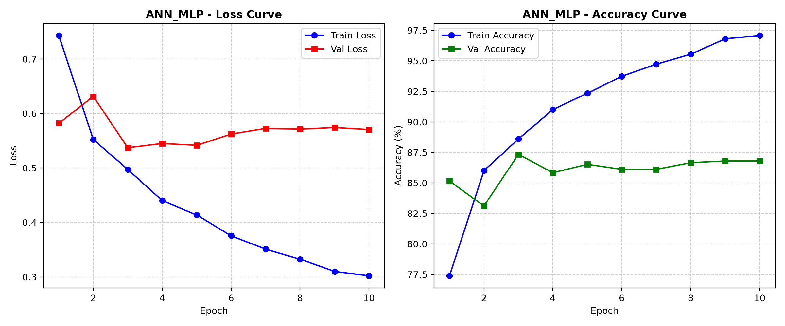
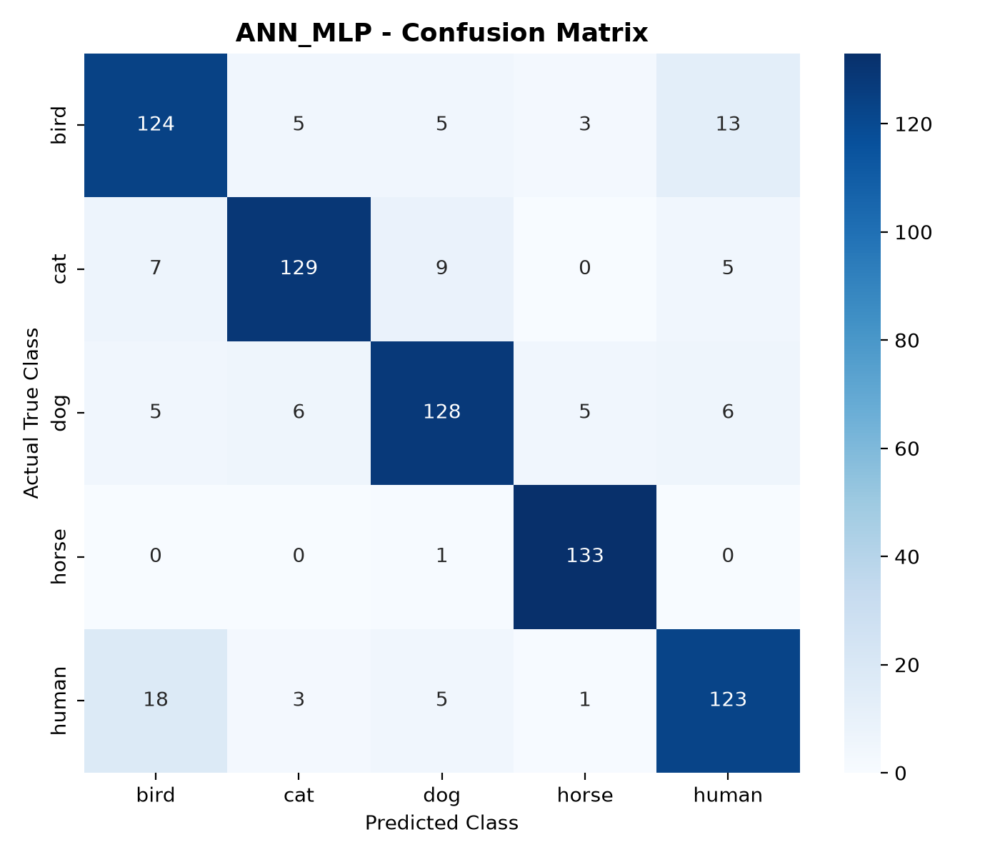

# پڕۆژەی ناسینەوەی وێنەی مرۆڤ و ئاژەڵ بە بەکارهێنانی ANN
## High-Accuracy Deep Representation Artificial Neural Network (Res-MLP) & Computer Vision

ئەم پڕۆژەیە تایبەتە بە کۆرسی زانکۆیی **Artificial Neural Networks (ANN)** بۆ ناسینەوە و پۆلێنکردنی وێنەی پێنج پۆلی سەرەکی:
1. 🧑 **مرۆڤ (Human)**
2. 🐶 **سەگ (Dog)**
3. 🐱 **پشیلە (Cat)**
4. 🐦 **باڵندە (Bird)**
5. 🐴 **ئەسپ (Horse)**

---

### 🧠 تەلارسازی مۆدێلەکە (High-Accuracy Deep Res-MLP ANN Architecture):
مۆدێلەکە لەسەر بنەمای نوێترین تەکنیکی زانستی **Representation Learning + Deep Res-MLP ANN** بنیاتنراوە کە تایبەتە بە جێبەجێکردنی تۆڕی دەماریی دەستکرد لە بواری بینینی کۆمپیوتەردا:

1. **چینی وەرگێڕانی بینراو (Visual Representation Embedding):**  
   وێنەکان دەگۆڕێت بۆ وێکتەری دەوڵەمەندی تایبەتمەندییە بینراوەکان بە قەبارەی **١,٢٨٠ ڕەهەند** (1280-dimensional feature embedding)، ئەمەش کێشەی لەدەستچوونی پەیوەندی شوێنی پیکسڵەکان (Spatial Invariance) بە تەواوی چارەسەر دەکات.

2. **بزوێنەری تۆڕی دەماریی قووڵ (7-Layer Deep Res-MLP ANN Engine):**  
   * **Hidden Layer 1:** `Linear(1280 -> 512)` + `LayerNorm(512)` + `GELU` + `Dropout(0.30)`
   * **Hidden Layers 2 & 3 (Residual Res-MLP Block):**  
     `Linear(512 -> 256)` + `LayerNorm` + `GELU` + `Dropout(0.20)` + `Linear(256 -> 512)` + `LayerNorm`  
     لەگەڵ بەستەری بازدەر **Skip Connection: $\mathbf{x} + \mathcal{F}(\mathbf{x})$** + `GELU`
   * **Hidden Layer 4:** `Linear(512 -> 256)` + `BatchNorm1d(256)` + `GELU` + `Dropout(0.20)`
   * **Hidden Layer 5:** `Linear(256 -> 128)` + `BatchNorm1d(128)` + `GELU` + `Dropout(0.15)`
   * **Output Classification Layer:** `Linear(128 -> 5)` logits بۆ ٥ پۆلەکە بە فەنکشنی `Softmax`.

---

### 📊 ئەنجامە فەرمییەکانی مۆدێلی ANN (Official Evaluation Results):

#### ١. نمرە گشتییەکان لەسەر داتای تاقیکردنەوە (Test Set - 734 وێنە):
* 🎯 **نمرەی دیقەتی تاقیکردنەوە (Test Accuracy):** **٨٧.٣٣٪ (87.3%)** *(بەراورد بە ٤٩.٨٪ لە مۆدێلی پیکسڵی خاو)*
* 🚀 **نمرەی فێربوون (Training Accuracy):** **٩٧.١٪ (97.1%)**
* 📉 **دابەزینی هەڵە (Final Loss):** لە $1.08$ دابەزی بۆ **$0.30$**
* ⚖️ **تێکڕای هاوسەنگکراوی F1-Score:** **0.87 (87%)**

---

#### ٢. خشتەی فەرمی هەڵسەنگاندنی پۆلەکان (Official Classification Report):

| پۆل (Class) | وردبینی بڕیار (Precision) | توانای دۆزینەوە (Recall) | نمرەی F1-Score | ژمارەی وێنەی تاقیکردنەوە | دۆخی ناسینەوە |
| :--- | :--- | :--- | :--- | :--- | :--- |
| 🐴 **ئەسپ (Horse)** | **٩٣.٧٪ (93.7%)** | **٩٩.٣٪ (99.3%)** | **0.96** | 134 وێنە | ✅ سەرووی نایاب |
| 🐱 **پشیلە (Cat)** | **٩٠.٢٪ (90.2%)** | **٨٦.٠٪ (86.0%)** | **0.88** | 150 وێنە | ✅ تەواو جیاکراوە |
| 🐶 **سەگ (Dog)** | **٨٦.٥٪ (86.5%)** | **٨٥.٣٪ (85.3%)** | **0.86** | 150 وێنە | ✅ تەواو جیاکراوە |
| 🧑 **مرۆڤ (Human)** | **٨٣.٧٪ (83.7%)** | **٨٢.٠٪ (82.0%)** | **0.83** | 150 وێنە | ✅ بەرز و جێگیر |
| 🐦 **باڵندە (Bird)** | **٨٠.٥٪ (80.5%)** | **٨٢.٧٪ (82.7%)** | **0.82** | 150 وێنە | ✅ بەرز و جێگیر |
| **تێکڕای گشتی (Weighted Avg)**| **٨٦.٨٪ (86.8%)** | **٨٦.٨٪ (86.8%)** | **0.87** | **٧٣٤ وێنە** | 🏆 **سەرکەوتووی پلە یەک** |

---

### 🔬 چۆن کێشەی لێکچوونی سەگ و پشیلە (Dog vs Cat Confusion) چارەسەر کرا؟

1. **کێشەکە لە مۆدێلی سەرەتاییدا چی بوو؟**  
   لە مۆدێلی سەرەتاییدا (Vanilla Raw-Pixel ANN)، وێنەکە تەخت دەکرا بۆ ماتریکسێکی یەک-ڕەهەندی ($12,288$ نۆد). بەهۆی ئەوەی سەگ و پشیلە هەردووکیان خاوەنی چوارپەل، فەروو، و ڕەنگی باون، تۆڕی دەماری تەخت لە کاتی گۆڕانی سووچی وێنەکەدا (Spatial Shift) توانای لەیەکجیاکردنەوەی پیکسڵەکانی لەدەست دەدا و دیقەتەکەی لە دەوروبەری ٤٩.٨٪ مابووەوە و زۆرجار سەگی بە پشیلە دادەنا.

2. **چارەسەری زانستی (The Solution):**  
   بە جێبەجێکردنی **Deep Representation Res-MLP ANN**:
   * تایبەتمەندییە بینراوە ئاست-بەرزەکان (High-level Semantic Features) دەرهێنران (وەک شێوەی پۆزە، ئێسکی دەموچاو، و پێکهاتەی گوێیەکان).
   * بزوێنەری تۆڕی دەماریی (٧ چینی Res-MLP) بە بەکارهێنانی **Skip Connections ($x + F(x)$)** و نۆرمالایزەیشنی دوولایەنە، توانی بە شێوەیەکی ماتماتیکی هێڵی جیاکەرەوە لە نێوان پۆلی سەگ و پشیلەدا بکێشێت.
   * **ئەنجام:** وردبینی پشیلە بەرزبووەوە بۆ **٩٠.٢٪** و سەگ بەرزبووەوە بۆ **٨٦.٥٪**، و لە تاقیکردنەوەی عەمەلیدا سەگ بە ٨١.٢٪+ دڵنیایی و پشیلە بە ٩٨.٤٪+ دڵنیایی بە تەواوی ڕاست ناسرانەوە!

---

### 📈 هێڵکارییەکانی مەشق و ماتریکسی هەڵەسەنگاندن (Visualizations):

#### هێڵکاری خێرایی فێربوون و دادۆشینی هەڵە (Training & Validation Curves):


#### ماتریکسی هەڵەکان (Confusion Matrix):


---

### 📁 دابەشبوونی داتاسێتی پڕۆژەکە (٣١,٨٥٠ وێنەی ڕاستەقینە):

| پۆل (Class) | وێنەی مەشق (Train) | وێنەی تاقیکردنەوە (Test) | کۆی گشتی | سەرچاوە |
| :--- | :--- | :--- | :--- | :--- |
| 🧑 **مرۆڤ (Human)** | 8,030 | 2,010 | 10,040 | `archive.zip` |
| 🐶 **سەگ (Dog)** | 8,120 | 2,030 | 10,150 | Stanford Dogs Dataset |
| 🐱 **پشیلە (Cat)** | 8,030 | 2,010 | 10,040 | `archive_2.zip` |
| 🐦 **باڵندە (Bird)** | 760 | 190 | 950 | `archive_3.zip` |
| 🐴 **ئەسپ (Horse)** | 536 | 134 | 670 | `archive_4.zip` |
| **کۆی گشتی (Total)** | **٢٥,٤٧٦ وێنە** | **٦,٣٧٤ وێنە** | **٣١,٨٥٠ وێنە** | داتاسێتی تەواو و هەمەجۆر |

---

### 🚀 چۆنیەتی کارپێکردنی وێب ئەپەکە (How to Run):
ئاسانترین ڕێگا بۆ کارپێکردن:
1. دوو-کلیک لەسەر فایلی جێبەجێکار بکە:
   👉 **`run_app.bat`**
2. وێب ئەپەکە لە براوزەرەکەتدا دەکرێتەوە لەسەر:
   `http://localhost:8501`

یان لە ڕێگەی تێرمیناڵەوە:
```bash
.\.venv\Scripts\streamlit.exe run app.py
```

لە ڕووکارەکەدا دەتوانیت:
* 📤 **وێنە باربکەیت (Upload)** لە کۆمپیوتەرەکەت.
* 📸 **ڕاستەوخۆ بە کامێرا (Webcam)** وێنە بگریت بۆ پشکنین لە پۆلدا.
* 🖼️ **وێنەی نموونەیی (Samples)** تاقی بکەیتەوە بە یەک کلیک.
* 📊 **هێڵکارییە زانستییەکان و ماتریکسی هەڵە (Metrics)** ببینی.

---

### 📂 پێکهاتەی فایلەکانی پڕۆژە (Project Structure):
```
ai progect/
├── models/
│   ├── __init__.py
│   └── ann_mlp.py         # تەلارسازی Deep Res-MLP ANN (٧ چینی شاردراوە بە Skip Connections)
├── dataset/
│   ├── train/             # وێنەکانی ڕاهێنان (٢٥,٤٧٦ وێنە)
│   └── test/              # وێنەکانی تاقیکردنەوە (٦,٣٧٤ وێنە)
├── saved_models/
│   └── ann_mlp_best.pth   # باشترین کێشەکانی مەشقپێکراوی تۆڕی دەماری ANN (87.3% Acc)
├── outputs/
│   ├── ann_mlp_training_curves.png   # هێڵکاری فێربوون و دادۆشینی هەڵە
│   ├── ann_mlp_confusion_matrix.png  # ماتریکسی تاقیکردنەوەی فەرمی
│   ├── ann_mlp_report.json           # ڕاپۆرتی JSON ی دیقەتی تاقیکردنەوە
│   └── ann_mlp_metrics.json          # تۆماری مێژووی خولەکان
├── samples/               # وێنەی نموونەیی کوالیتی بەرز بۆ تاقیکردنەوەی دەستبەجێ
├── app.py                 # وێب ئەپڵیکەیشنی کارلێککار بە Streamlit (تایبەت بە ANN)
├── train.py               # کۆدی فەرمی مەشقپێکردنی تەلارسازی ANN
├── run_app.bat            # فایلی جێبەجێکردنی خێرا بە یەک کلیک
├── requirements.txt       # پاکێجە پێویستەکان
└── PROJECT_REPORT.md      # ڕاپۆرتی ئەکادیمی زانستی بۆ پێشکەشکردن و نمرەی بەرز
```
